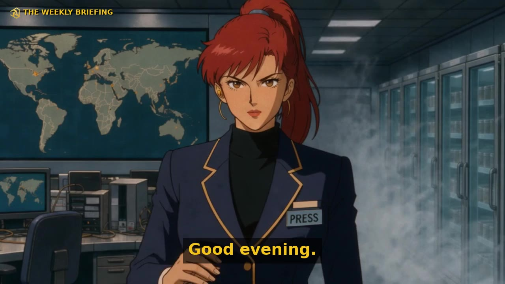

# Anime News

A headline in, an anime news episode out. Anime News writes a storyboard from a news headline, renders a start frame and a Seedance shot for every beat through Comfy Router, and cuts them into a fast anime news episode, on your own machine with your own key.

**Site:** https://anime-news-nine.vercel.app ([episodes](https://anime-news-nine.vercel.app/episodes), [studio](https://anime-news-nine.vercel.app/studio))



## Three ways to use it

**1. The hosted site with your local engine.** Start the engine on your computer, then open the [Studio](https://anime-news-nine.vercel.app/studio). The page finds the engine on `http://127.0.0.1:8765`, and you write, edit and render from the browser. Needs [uv](https://docs.astral.sh/uv/) and `ffmpeg` (macOS: `brew install uv ffmpeg`).

```bash
uvx --from "git+https://github.com/iamnolanhu/anime-news#subdirectory=packages/engine" anime-news serve
```

**2. Fully local.** The same command serves the engine's own page on `http://127.0.0.1:8765`, so nothing but the model calls leaves your machine.

**3. The CLI.** One headline, one episode, no browser:

```bash
uvx --from "git+https://github.com/iamnolanhu/anime-news#subdirectory=packages/engine" anime-news make "Mayor bans Mondays"
```

Try the Studio without installing anything: [https://anime-news-nine.vercel.app/studio?mock=1](https://anime-news-nine.vercel.app/studio?mock=1) runs a stand-in engine inside the page.

## The Weekly Briefing

The show is **THE WEEKLY BRIEFING**: one episode per week with that week's top headline in each of five topics (AI, crypto,
politics, tech, markets), signed off "Back next week." `anime-news weekly --week 2026-W44` builds one; `--weeks 2026-W01..2026-W44`
backfills the year. Details, the manifest shape and the backfill run: [docs/WEEKLY.md](docs/WEEKLY.md).

An hourly self-running channel still exists in the code (`shot-director-episode --loop --every 60m`, or `SHOT_DIRECTOR_AUTO=1`
on the server). It is optional and off by default; we may turn it on if we get sponsored compute.

## Your key stays on your machine

You bring a Comfy API key (platform.comfy.org, API Keys). The Studio keeps it in your browser's localStorage and hands it to the engine on `127.0.0.1` (it refuses to send it to any other engine URL); the engine stores it in `~/.anime-news/config.json` with 0600 permissions. Storyboards and videos live in `~/.anime-news/` and in your browser.

The website is static. It never receives your key, your storyboards or your videos: the browser talks to your engine directly, and the engine talks to Comfy Router. The optional "Check with Comfy" button sends the key from your browser straight to `api.comfy.org`. Site analytics (PostHog, with every input masked in replays) never load on localhost.

## Architecture

| Path | What it is |
| --- | --- |
| `apps/web` | The site: Next.js 16, Tailwind v4, Bun. Landing page, episode gallery (`content/episodes.json` + `public/episodes/`), and the Studio, which is a browser client for the local engine |
| `packages/engine` | The engine: Python, FastAPI, ffmpeg. The `anime-news` CLI and the local HTTP API below. Details in [packages/engine/README.md](packages/engine/README.md) |

The pipeline, one episode:

1. **Headline.** A headline, plus the article text or link if you have one, and a length from 30 seconds to 5 minutes.
2. **Storyboard.** One writer call on Comfy Router returns the cast and the scenes (cold open, setup, escalation, turn, climax, sign-off), about 4 scenes a minute with 3 to 6 shots each. No cap on shots or scenes; edit anything before rendering.
3. **Stills.** Every shot gets its own FLUX start frame from its own prompt and the cast sheet.
4. **Shots.** Each frame becomes a Seedance clip: talking takes carry their own voice, action takes carry the motion. Shots render in parallel.
5. **Sound.** Narration through ElevenLabs on Comfy Router, a music bed with a riser and drop, whooshes and impacts on scene changes.
6. **The cut.** ffmpeg cuts 35 to 42 times a minute with subtitles, the series title after the cold open and a countdown. No source moment is shown twice. Output in 16:9 and 9:16.

## Engine API

The engine listens on `http://127.0.0.1:8765`. CORS allows the site's origin (`ANIME_NEWS_ALLOWED_ORIGINS`, comma list; default `https://anime-news-nine.vercel.app,http://localhost:3000,http://127.0.0.1:3000`) and answers Chrome's private-network preflight.

| Method | Path | Body | Returns |
| --- | --- | --- | --- |
| GET | `/api/health` | | `{ok: true, version, mode: "live"\|"mock", has_credential: bool}` |
| GET | `/api/config` | | `{has_credential: bool, mode, media_dir}` (never the key itself) |
| PUT | `/api/config` | `{comfy_api_key: string}` | `{has_credential: true, mode: "live"}`; an empty string clears it |
| POST | `/api/storyboard` | `{headline: string, text?: string, url?: string, minutes?: number (default 1, max 5), style?: string}` | `{storyboard}`. 400 on an empty headline, 502 when the writer fails (mock mode returns a template storyboard) |
| POST | `/api/render` | `{storyboard, quality?: "480p"\|"720p" (default "480p"), vertical?: bool}` | 202 `{job_id}`; 409 while a render is running |
| GET | `/api/jobs/{id}` | | `{job_id, status: "queued"\|"rendering"\|"cutting"\|"done"\|"failed", stage, done, total, started, error?, episode?: {id, mp4_url, vertical_url?, duration, shots, cuts_per_minute}}` |
| DELETE | `/api/jobs/{id}` | | cancels, best effort: `{cancelled: true}` |
| GET | `/api/episodes` | | `{episodes: [{id, headline, created, mp4_url, vertical_url?, duration, shots, quality, cost_estimate?}]}` |
| GET | `/media/{file}` | | the file (mp4, png, json) |

Storyboard JSON:

```json
{ "id": "", "headline": "", "source_text_excerpt": "", "series": "THE WEEKLY BRIEFING", "logline": "", "minutes": 1,
  "cast": [{ "id": "", "name": "", "role": "", "look": "", "voice": "" }],
  "scenes": [{ "id": "", "act": "cold_open|setup|escalation|turn|climax|sign_off", "setting": "", "caption": "", "narration": "",
               "shots": [{ "id": "", "kind": "talk|action|still|insert", "cast": [""], "line": "spoken line (optional)", "prompt": "", "move": "", "seconds": 5 }] }] }
```

## Development

```bash
bun install
bun run dev          # the site on http://localhost:3000 (turbo runs apps/web)
bun run build        # production build of the site

cd packages/engine
uv run anime-news serve   # the engine on http://127.0.0.1:8765
```

The Studio works without an engine at `http://localhost:3000/studio?mock=1`. To add an episode to the gallery, put `<slug>.mp4` (and `<slug>-9x16.mp4`, a poster `.jpg`) in `apps/web/public/episodes/` and add an entry at the top of `apps/web/content/episodes.json`. Brand and theme rules: [THEME.md](THEME.md).

## Credits

- Models through [Comfy Router](https://platform.comfy.org): FLUX for start frames, Seedance for shots, ElevenLabs for narration, a chat model for the writer.
- Music bed: used under the [Pixabay Content License](https://pixabay.com/service/license-summary/).
- Original characters only: no real people's likeness, no existing anime characters or studio styles.

Built for **Open Source Higgsfield: ComfyUI Build Night**, NYC, November 2026.

## License

MIT, see [LICENSE](LICENSE).
